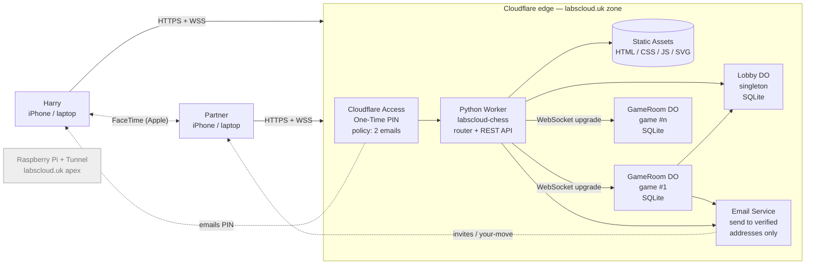
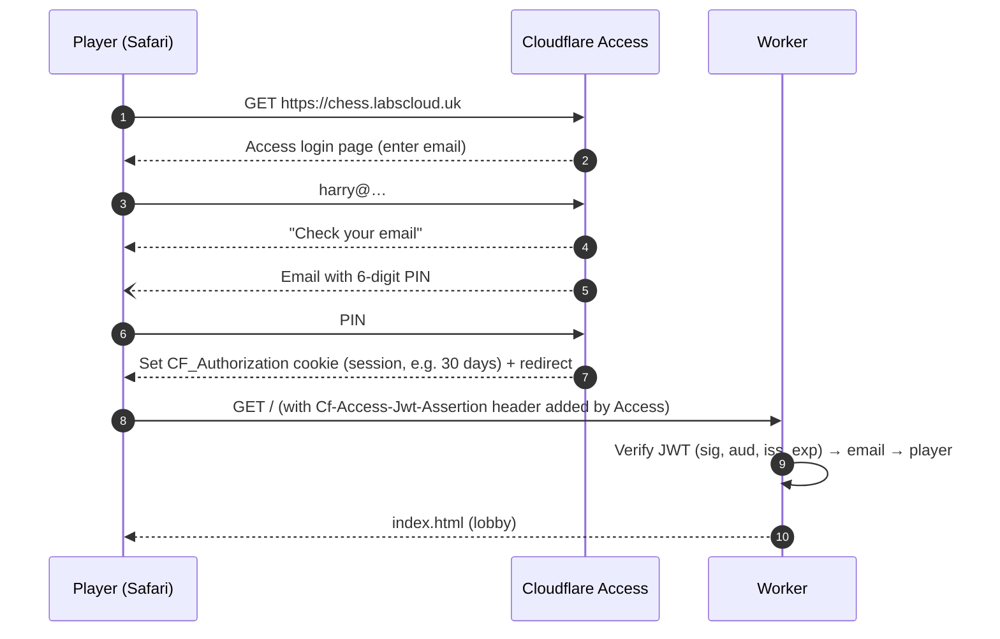

# labscloud-chess — Solution Architecture

> **Note (12 Oct 2026):** this is the original architecture. Where it differs from `docs/requirements.md`, `docs/protocol.md`, `docs/data-model.md`, `docs/platform-notes.md` or the ADRs in `docs/adr/`, those documents win. Notable changes: player keys instead of emails (ADR-0010), repetition counts instead of replay (ADR-0007), `/game/*` served by the Worker (ADR-0006), `PLAYERS_JSON` format (data model §4).

**Project:** Private two-player online chess at `chess.labscloud.uk`
**Owner:** Harry Graham
**Status:** Draft v1.0 — 12 October 2026
**Budget:** £0 running cost (time investment only)
**Language:** Python (server and game logic); a thin vanilla-JS view layer in the browser (no TypeScript, no build step)

---

## 0. TL;DR — the answers to your questions

| Question | Answer |
|---|---|
| Can Cloudflare host it? | **Yes, end to end, on free tiers.** Python Workers reached general availability in September 2026 and run on Cloudflare's edge via Pyodide (Python compiled to WebAssembly). Durable Objects (the real-time "game room") are on the Workers Free plan as SQLite-backed objects. Static files are served free and unlimited. |
| How do players get "a login via email"? | **Cloudflare Access with One-Time PIN.** You visit the site, type your email, Cloudflare emails you a PIN, you're in. Free up to 50 users; only your two addresses are allowed. Zero auth code to write or maintain. The app additionally emails each of you an **invite link** to each new game. |
| Can it email us invites / "your move" nudges for free? | **Yes, with one trick:** Cloudflare Email Service charges for sending to *arbitrary* recipients, but sending to **verified destination addresses** in your own account is free on all plans. With exactly two players, you verify both addresses once and it costs nothing. |
| Subdomain or path? | **`chess.labscloud.uk`** (recommended). Isolated from the Pi's tunnel on the apex, simpler Access policy, simpler asset paths, covered by the free Universal SSL certificate. |
| Does the Pi play any part? | **No.** Production lives entirely on Cloudflare. The Pi and its tunnel are untouched. Local development happens on your dev machine with `pywrangler dev`, which simulates Workers + Durable Objects + SQLite locally. |
| FaceTime alongside? | Keep video in FaceTime (better than anything you'd build). The app is designed mobile-first to sit underneath FaceTime picture-in-picture, survives app-switching (auto-reconnect + resync), and keeps the screen awake. |

---

## 1. Goals, non-goals and constraints

### 1.1 Functional goals
1. Exactly two authorised players (Harry + partner) can sign in via an emailed one-time code.
2. Either player can start a new game, pick colours (white / black / random), and the opponent is emailed an invite link.
3. Live, real-time move sync (sub-second) while both are online — designed for "on FaceTime together" play.
4. Also works asynchronously ("correspondence" mode): if the opponent is offline, they get a "your move" email (throttled).
5. Full legal-move enforcement: check, checkmate, stalemate, castling, en passant, promotion, draws (insufficient material, 75-move/fivefold automatic; threefold/50-move claimable).
6. Resign, offer/accept/decline draw, rematch (colours swap).
7. Game history list with PGN download; simple head-to-head scoreboard.

### 1.2 Non-functional goals
- **£0/month** forever at this scale; free-tier overruns must fail closed (errors), never bill.
- **Not on the Pi.** No dependency on home hardware or home broadband.
- **Python-first** codebase, testable locally without Cloudflare.
- Mobile-first UI (iPhone Safari next to FaceTime), works on desktop too.
- Secure by default: nothing reachable without passing Access; no public `workers.dev` URL.

### 1.3 Non-goals (v1)
- Public matchmaking, more than two users, ratings/ELO, chess engine/AI opponent, in-app video/voice, spectators, chat (you're on FaceTime).

### 1.4 Constraints that shape the design
| Constraint | Source | Design impact |
|---|---|---|
| 10 ms CPU per invocation on Workers Free | Workers limits | Keep per-message work tiny; cache board in memory; benchmark `python-chess` in Pyodide early (see §12, Risk R1). |
| 100,000 requests/day on Workers Free | Workers limits | Irrelevant at this scale (a heavy day is < 2,000). |
| Durable Objects Free: SQLite-backed only, 5 GB account storage | DO limits | Use `new_sqlite_classes`. A game is a few KB. |
| Email sending to arbitrary recipients needs Workers Paid | Email Service pricing | Send only to the two **verified** addresses (free). |
| Browsers execute JavaScript, not Python | Physics of the web | Thin vanilla-JS view; **all chess rules live server-side in Python.** Client receives the list of legal moves from the server, so no JS chess library is needed. |
| Python Workers only recently GA | Release timing | Pin `compatibility_date`; treat `pywrangler init` output as the source of truth for config shape. |

---

## 2. Architecture overview

### 2.1 Context diagram



The Pi is shown only to make the point: it is **not** in the request path.

### 2.2 Components

| Component | Tech | Responsibility |
|---|---|---|
| **Cloudflare Access app** | Zero Trust Free | Gatekeeper for `chess.labscloud.uk/*`. One-Time PIN login. Allow-list of exactly two emails. Issues a signed JWT (`Cf-Access-Jwt-Assertion`) on every request. |
| **Worker `labscloud-chess`** | Python Worker (Pyodide) | Verifies the Access JWT, resolves the player, serves static assets, exposes the REST API, upgrades WebSockets and forwards them to the right `GameRoom`. Stateless. |
| **Static assets** | Workers Static Assets | `index.html` (lobby), `game.html` (board), `js/*.js` ES modules, `css/app.css`, self-hosted fonts, PWA manifest/icons. Served without invoking Python (free, unlimited, fast). |
| **`Lobby` Durable Object** | Python DO + SQLite | Singleton (`idFromName("lobby")`). Player profiles, game index, head-to-head stats, notification preferences, last-notified timestamps. |
| **`GameRoom` Durable Object** | Python DO + SQLite + `python-chess` | One instance per game. **Authoritative** game state, move validation, clocks (optional), draw/resign/rematch logic, WebSocket fan-out using the **Hibernation API**, presence, "your move" notifications. |
| **Email Service** | `send_email` binding | Invites, "your move" nudges, game-over summary with PGN. Only to the two verified destination addresses. |
| **Frontend** | Vanilla JS (ES modules), hand-rolled board (ADR-0005, revised) | Renders board, handles drag/tap input, promotion picker, move list, connection status. **No rules logic.** |

### 2.3 Why this shape (architectural decision records)

**ADR-1 — Cloudflare Workers, not the Pi or a free VPS.**
Free tiers that never sleep, global edge (you're at opposite ends of the country — both get a nearby PoP), DNS already on Cloudflare via the existing tunnel, automatic TLS, and overruns fail rather than bill. Free container PaaS options tend to sleep idle apps (slow first move) or have shifting free tiers.

**ADR-2 — Durable Objects for live state, not D1/KV.**
A chess game is a tiny, strongly consistent, single-writer state machine with two live connections — exactly the Durable Object model: one object per game, single-threaded, co-located storage, built-in WebSocket fan-out. KV is eventually consistent (wrong for moves). D1 would need a separate pub/sub for real-time. The Hibernation API means idle games cost nothing while WebSockets stay connected.

**ADR-3 — Cloudflare Access One-Time PIN for login, not home-grown magic links.**
It *is* "a login sent via email", it's free for ≤ 50 users, it handles PIN generation, expiry, rate limiting, session cookies and email delivery, and it blocks every request before your code runs. Home-grown auth is the riskiest code in any project; for two users it's pure liability. (A self-built alternative is documented in Appendix C if you want it as a learning exercise.)

**ADR-4 — Server-authoritative rules in Python (`python-chess`).**
Single source of truth, impossible to cheat by editing JS, and it satisfies "Python not TypeScript": the browser never needs chess knowledge because the server sends legal moves with every state update.

**ADR-5 — Vanilla JS view layer, not PyScript/Pyodide-in-the-browser.**
Running Python in the browser means a multi-megabyte runtime download per device and sluggish start-up on phones — a poor fit for "open the link while on FaceTime". ~300 lines of plain JS (no TypeScript, no bundler, no npm build) is the pragmatic minimum.

**ADR-6 — `chess.labscloud.uk` over `labscloud.uk/chess`.**
A Worker Custom Domain on a subdomain gets its own DNS record and certificate automatically, its own Access application, its own cookie scope, and no routing interplay with the Pi tunnel on the apex. A path route would work (Worker routes take precedence over the tunnel origin for matching paths) but every asset URL, the Access app and cookies then have to carry `/chess`, and a misconfigured route could shadow the Pi's site.

---

## 3. Request flows

### 3.1 First login (One-Time PIN)



### 3.2 Creating a game and inviting the opponent

```mermaid
sequenceDiagram
    autonumber
    participant H as Harry
    participant W as Worker
    participant L as Lobby DO
    participant R as GameRoom DO
    participant E as Email Service
    participant G as Partner
    H->>W: POST /api/games {colour:"random"}
    W->>L: create_game(creator=harry, colour=random)
    L->>L: id = uuid4(); assign colours; insert index row
    L->>R: init(id, white, black, settings)
    R->>R: CREATE tables; store start FEN
    L->>E: send invite → partner (verified address)
    L-->>W: {id, url:"/game/{id}"}
    W-->>H: 201 + redirect to /game/{id}
    E--)G: "Harry challenged you — you're Black ♟ [Play]"
```

### 3.3 Live move (both online, on FaceTime)

```mermaid
sequenceDiagram
    autonumber
    participant H as Harry (white)
    participant R as GameRoom DO
    participant G as Partner (black)
    H->>R: {"type":"move","uci":"e2e4","ply":0}
    R->>R: auth: socket colour == side to move?<br/>ply matches? (optimistic concurrency)
    R->>R: python-chess: legal? push; derive SAN, FEN, status
    R->>R: INSERT moves row; UPDATE game row
    R-->>H: {"type":"state", …, "last":"e4"}
    R-->>G: {"type":"state", …, "last":"e4", "legal":[…]}
    Note over R: No timers pending → eligible to hibernate.<br/>Sockets stay open; no duration billing while idle.
```

### 3.4 Opponent offline (correspondence)

After persisting a move, `GameRoom` checks `ctx.getWebSockets(tag=opponent_colour)`. If empty, it asks `Lobby` whether a nudge is allowed (opponent opted in, and no nudge in the last *N* minutes, default 30). If so, it sends a "Your move vs Harry — 1. e4" email with a deep link.

### 3.5 Reconnect / resync (iPhone app switching)

iOS will suspend Safari's WebSocket when you swipe to FaceTime full-screen. The client therefore:
1. Listens for `visibilitychange` and `online` events and on socket `close`.
2. Reconnects with exponential back-off (0.5 s → 8 s, jittered).
3. Sends `{"type":"hello","since_ply":N}`; server always replies with a **full state snapshot** (so the client never has to replay deltas).
4. Shows a small "Reconnecting…" pill; disables move input until `state` arrives.

---

## 4. Real-time protocol (WebSocket, JSON)

Endpoint: `wss://chess.labscloud.uk/ws/games/{game_id}` (cookie-authenticated by Access; Worker verifies JWT before upgrading).

### 4.1 Client → server

| `type` | Payload | Notes |
|---|---|---|
| `hello` | `{since_ply}` | Sent on every (re)connect. |
| `move` | `{uci, ply}` | `uci` like `e7e8q`; `ply` = number of half-moves the client believes have been played (rejects stale/duplicate submits). |
| `resign` | `{}` | |
| `draw_offer` / `draw_accept` / `draw_decline` | `{}` | |
| `claim_draw` | `{}` | Only valid when threefold/50-move claimable. |
| `rematch` | `{}` | Both must send → Lobby creates new game with colours swapped. |
| `ping` | `{}` | Optional; Cloudflare's auto ping/pong also keeps hibernation intact. |

### 4.2 Server → client

| `type` | Payload |
|---|---|
| `state` | `{game_id, fen, ply, turn, you, white, black, moves:[san…], last:{uci,san}, legal:[uci…] (only to side to move), check, status, result, draw_offer_from, can_claim_draw, opponent_online}` |
| `presence` | `{white_online, black_online}` |
| `error` | `{code, message}` e.g. `NOT_YOUR_TURN`, `ILLEGAL_MOVE`, `STALE_PLY`, `GAME_OVER` |

`status` ∈ `waiting | active | checkmate | stalemate | insufficient_material | seventyfive_moves | fivefold_repetition | draw_claimed | draw_agreed | resigned | aborted`.

### 4.3 Validation rules (server)
- Reject if sender's socket colour ≠ side to move.
- Reject if `ply` ≠ current ply (prevents double-taps and races).
- `uci` must match `^[a-h][1-8][a-h][1-8][qrbn]?$` before touching `python-chess`.
- Reject any action when `status` is terminal.

---

## 5. REST API (Worker)

All routes sit behind Access. Responses are JSON. The Worker passes the verified player email to Durable Objects; DOs are never reachable directly from the internet.

| Method & path | Purpose |
|---|---|
| `GET /api/me` | Current player (email, display name, notification prefs). |
| `PATCH /api/me` | Update display name / notification prefs. |
| `GET /api/games?status=active|finished` | Game list for the lobby. |
| `POST /api/games` | `{colour: white|black|random}` → creates game, emails invite. |
| `GET /api/games/{id}` | Snapshot (fallback if WebSocket blocked). |
| `GET /api/games/{id}/pgn` | PGN download. |
| `GET /api/stats` | Head-to-head W/D/L. |
| `GET /ws/games/{id}` | WebSocket upgrade → `GameRoom`. |
| `GET /*` | Static assets (lobby `/`, board `/game/{id}` → `game.html` via SPA fallback). |

---

## 6. Data model

### 6.1 `Lobby` DO (SQLite)

```sql
CREATE TABLE IF NOT EXISTS players (
  email            TEXT PRIMARY KEY,
  display_name     TEXT NOT NULL,
  notify_invites   INTEGER NOT NULL DEFAULT 1,
  notify_your_move INTEGER NOT NULL DEFAULT 1,
  nudge_cooldown_m INTEGER NOT NULL DEFAULT 30,
  last_nudged_at   INTEGER            -- epoch ms
);

CREATE TABLE IF NOT EXISTS games (
  id          TEXT PRIMARY KEY,       -- uuid4
  white       TEXT NOT NULL REFERENCES players(email),
  black       TEXT NOT NULL REFERENCES players(email),
  status      TEXT NOT NULL,
  result      TEXT,                   -- '1-0' | '0-1' | '1/2-1/2' | NULL
  ply         INTEGER NOT NULL DEFAULT 0,
  created_at  INTEGER NOT NULL,
  updated_at  INTEGER NOT NULL,
  rematch_of  TEXT
);
CREATE INDEX IF NOT EXISTS games_updated ON games(updated_at DESC);
```

### 6.2 `GameRoom` DO (SQLite, one database per game)

```sql
CREATE TABLE IF NOT EXISTS game (
  id               TEXT PRIMARY KEY,
  white            TEXT NOT NULL,
  black            TEXT NOT NULL,
  start_fen        TEXT NOT NULL,
  current_fen      TEXT NOT NULL,
  ply              INTEGER NOT NULL,
  status           TEXT NOT NULL,
  result           TEXT,
  draw_offer_from  TEXT,              -- 'white' | 'black' | NULL
  rematch_votes    TEXT,              -- JSON list
  created_at       INTEGER NOT NULL,
  updated_at       INTEGER NOT NULL
);

CREATE TABLE IF NOT EXISTS moves (
  ply        INTEGER PRIMARY KEY,     -- 1-based half-move number
  uci        TEXT NOT NULL,
  san        TEXT NOT NULL,
  fen_after  TEXT NOT NULL,
  by_colour  TEXT NOT NULL,
  played_at  INTEGER NOT NULL
);
```

**Why store both moves and `current_fen`?** `current_fen` makes the hot path cheap (construct board from one FEN). The `moves` table is the source of truth for PGN and repetition detection; it's replayed only when the object wakes from hibernation and the in-memory board is gone.

**Lobby ↔ GameRoom consistency.** `GameRoom` is authoritative for a game. After each state change it makes a fire-and-forget RPC to `Lobby.update_game_summary(id, status, result, ply)`. If that ever fails, the lobby list is merely stale; the next move fixes it.

---

## 7. Code structure

```
labscloud-chess/
├── pyproject.toml            # uv-managed; python-chess, pytest, websockets (dev)
├── wrangler.jsonc            # generated by `pywrangler init`, then edited
├── README.md
├── src/
│   ├── entry.py              # WorkerEntrypoint: routing, auth, asset fallthrough
│   ├── auth.py               # Access JWT verification (+ dev bypass)
│   ├── api.py                # REST handlers
│   ├── lobby.py              # Lobby Durable Object
│   ├── game_room.py          # GameRoom Durable Object (WebSocket hibernation)
│   ├── notify.py             # Email composition + send via binding
│   └── chess_core/           # PURE PYTHON — no Workers imports, fully unit-testable
│       ├── __init__.py
│       ├── engine.py         # ChessGame wrapper around python-chess
│       ├── protocol.py       # message dataclasses, validation, (de)serialisation
│       └── pgn.py
├── public/
│   ├── index.html            # lobby
│   ├── game.html             # board
│   ├── app.js                # ~300 lines vanilla ES module
│   ├── styles.css
│   ├── manifest.webmanifest
│   ├── sounds/{move,capture,check}.mp3
│   └── icons/
├── tests/
│   ├── test_engine.py
│   ├── test_protocol.py
│   └── test_pgn.py
├── scripts/
│   ├── simulate_two_players.py   # drives two WebSocket clients against `pywrangler dev`
│   └── bench_engine.py           # CPU timing for the 10 ms budget
└── .github/workflows/
    ├── test.yml              # pytest on every push
    └── deploy.yml            # pywrangler deploy on main
```

**Key layering rule:** `chess_core` knows nothing about Cloudflare. `game_room.py` is a thin adapter that translates WebSocket messages into `chess_core` calls and results into storage writes and broadcasts. This is what lets you develop and test the hard part with plain `pytest` on your laptop.

> **As built (12 Oct 2026):** the tree above was the first sketch. The real layout is in `CLAUDE.md` → *Layout*: pure services live in `src/app/`, runtime glue in `src/entry.py`, `src/game_room.py`, `src/lobby.py`, `src/glue.py`, and workflows are `ci.yml`, `deploy-staging.yml`, `deploy-prod.yml`, `rollback.yml`.

### 7.1 `wrangler.jsonc` (indicative — reconcile with what `pywrangler init` generates)

```jsonc
{
  "name": "labscloud-chess",
  "main": "src/entry.py",
  "compatibility_date": "2026-10-01",
  "compatibility_flags": ["python_workers"],   // keep if pywrangler emits it

  // Security: no public *.workers.dev or preview URLs that would bypass Access
  "workers_dev": false,
  "preview_urls": false,

  "routes": [
    { "pattern": "chess.labscloud.uk", "custom_domain": true }
  ],

  "assets": {
    "directory": "./public",
    "binding": "ASSETS",
    "not_found_handling": "single-page-application",
    "run_worker_first": ["/api/*", "/ws/*"]
  },

  "durable_objects": {
    "bindings": [
      { "name": "GAME_ROOM", "class_name": "GameRoom" },
      { "name": "LOBBY",     "class_name": "Lobby" }
    ]
  },
  "migrations": [
    { "tag": "v1", "new_sqlite_classes": ["GameRoom", "Lobby"] }
  ],

  "send_email": [
    { "name": "EMAIL" }
  ],

  "vars": {
    "APP_ENV": "production",
    "PUBLIC_URL": "https://chess.labscloud.uk",
    "MAIL_FROM": "chess@labscloud.uk",
    "ACCESS_TEAM_DOMAIN": "https://<your-team>.cloudflareaccess.com"
  }
  // Secrets (set with `pywrangler secret put`): ACCESS_AUD, PLAYERS_JSON
}
```

> Note on static assets and Access: `run_worker_first` only controls *Worker* invocation. Access sits in front of the whole hostname, so assets are still protected.

### 7.2 Sketches (illustrative, not drop-in)

**`chess_core/engine.py`** — pure, testable

```python
from __future__ import annotations
import re
from dataclasses import dataclass
import chess

UCI_RE = re.compile(r"^[a-h][1-8][a-h][1-8][qrbn]?$")


@dataclass(frozen=True)
class MoveOutcome:
    ok: bool
    error: str | None = None
    uci: str | None = None
    san: str | None = None
    fen_after: str | None = None
    status: str = "active"
    result: str | None = None


class ChessGame:
    def __init__(self, start_fen: str = chess.STARTING_FEN, moves: list[str] | None = None):
        self.board = chess.Board(start_fen)
        for uci in moves or []:
            self.board.push_uci(uci)

    @property
    def ply(self) -> int:
        return len(self.board.move_stack)

    @property
    def turn(self) -> str:
        return "white" if self.board.turn == chess.WHITE else "black"

    def legal_moves(self) -> list[str]:
        return [m.uci() for m in self.board.legal_moves]

    def apply(self, colour: str, uci: str, expected_ply: int) -> MoveOutcome:
        if colour != self.turn:
            return MoveOutcome(False, "NOT_YOUR_TURN")
        if expected_ply != self.ply:
            return MoveOutcome(False, "STALE_PLY")
        if not UCI_RE.match(uci):
            return MoveOutcome(False, "BAD_FORMAT")
        move = chess.Move.from_uci(uci)
        if move not in self.board.legal_moves:
            return MoveOutcome(False, "ILLEGAL_MOVE")
        san = self.board.san(move)
        self.board.push(move)
        status, result = self._status()
        return MoveOutcome(True, None, uci, san, self.board.fen(), status, result)

    def _status(self) -> tuple[str, str | None]:
        b = self.board
        if b.is_checkmate():
            return "checkmate", ("1-0" if b.turn == chess.BLACK else "0-1")
        if b.is_stalemate():
            return "stalemate", "1/2-1/2"
        if b.is_insufficient_material():
            return "insufficient_material", "1/2-1/2"
        if b.is_seventyfive_moves():
            return "seventyfive_moves", "1/2-1/2"
        if b.is_fivefold_repetition():
            return "fivefold_repetition", "1/2-1/2"
        return "active", None

    def can_claim_draw(self) -> bool:
        # Repetition scans history: call on demand, not on every move, to protect the CPU budget.
        return self.board.can_claim_draw()
```

**`game_room.py`** — Durable Object adapter (hibernation-safe)

```python
import json, time
from workers import DurableObject, Response
from js import WebSocketPair
from chess_core.engine import ChessGame


class GameRoom(DurableObject):
    def __init__(self, ctx, env):
        super().__init__(ctx, env)
        self.ctx, self.env = ctx, env
        self.sql = ctx.storage.sql
        self._game: ChessGame | None = None  # lost on hibernation; rebuilt lazily
        self._migrate()  # CREATE TABLE IF NOT EXISTS …

    def game(self) -> ChessGame:
        if self._game is None:
            row = self._load_game_row()
            ucis = [r["uci"] for r in self.sql.exec("SELECT uci FROM moves ORDER BY ply")]
            self._game = ChessGame(row["start_fen"], ucis)
        return self._game

    async def fetch(self, request):
        # Worker has already verified Access and passes the player email + colour.
        email = request.headers.get("x-player-email")
        colour = self._colour_for(email)
        if colour is None:
            return Response("Forbidden", status=403)
        client, server = WebSocketPair.new().object_values()
        self.ctx.acceptWebSocket(server, [colour])  # tag = colour, for presence lookups
        server.serializeAttachment(json.dumps({"email": email, "colour": colour}))
        self._broadcast_presence()
        return Response(None, status=101, web_socket=client)

    async def webSocketMessage(self, ws, raw):
        who = json.loads(ws.deserializeAttachment())
        msg = json.loads(raw)
        match msg.get("type"):
            case "hello":
                ws.send(json.dumps(self._state_for(who["colour"])))
            case "move":
                out = self.game().apply(who["colour"], msg["uci"], msg["ply"])
                if not out.ok:
                    self._game = None  # discard any partial in-memory state; rebuild next time
                    ws.send(json.dumps({"type": "error", "code": out.error}))
                    return
                self._persist_move(out, who["colour"])
                self._broadcast_state()
                await self._maybe_nudge_opponent(who["colour"])
            # resign / draw_* / claim_draw / rematch …

    async def webSocketClose(self, ws, code, reason, was_clean):
        self._broadcast_presence()

    def _broadcast_state(self):
        for ws in self.ctx.getWebSockets():
            colour = json.loads(ws.deserializeAttachment())["colour"]
            ws.send(json.dumps(self._state_for(colour)))
```

**`auth.py`** — Access JWT verification

- Read `Cf-Access-Jwt-Assertion` header.
- Fetch and cache JWKS from `{ACCESS_TEAM_DOMAIN}/cdn-cgi/access/certs` (module-level cache; refresh on unknown `kid`).
- Verify RS256 signature with the runtime's **WebCrypto** (`from js import crypto` → `crypto.subtle.importKey` / `verify`) — native, so it doesn't eat the Python CPU budget.
- Check `aud` == `ACCESS_AUD`, `iss` == team domain, `exp` in the future.
- Map `email` to a player via `PLAYERS_JSON` secret; anything else → 403 (defence in depth even though Access already filters).
- **Dev bypass:** only when `APP_ENV == "development"`, accept `?as=harry|partner` and skip JWT checks. Unit-test that production rejects it.

---

## 8. Frontend design

### 8.1 Pages
- **Lobby (`/`)** — "New game" button (colour picker), list of active games ("Your move" badge), finished games with result + PGN link, head-to-head score.
- **Board (`/game/{id}`)** — board auto-oriented to your colour; opponent name + online dot above; your name below; move list (SAN, scrollable); buttons: Offer draw, Resign (with confirm), Flip, Rematch (post-game); promotion picker modal; connection pill.

### 8.2 FaceTime-friendly UX
- **Portrait-first**: board fills width, controls below. FaceTime's picture-in-picture usually sits in a corner — keep critical controls away from the top corners; avoid full-screen modals.
- **Screen Wake Lock API** while a game is open so the phone doesn't dim mid-think.
- **Tap-tap** move input as well as drag (more reliable on touch); highlight legal targets from the server-supplied `legal` list.
- Subtle sound + `navigator.vibrate` (where supported) on opponent move, check and game end.
- Robust reconnect (§3.5).
- **PWA manifest** so it can be added to the Home Screen and opened like an app.

### 8.3 Libraries (no CDN, no build step)
- None. The board is hand-rolled (ADR-0005, revised); fonts are self-hosted.
- No chess-rules library in the browser.

---

## 9. Email design

| Email | Trigger | Sender | Recipient |
|---|---|---|---|
| Login PIN | User requests login | Cloudflare Access (handled for you) | Whoever typed an allowed email |
| Game invite | `POST /api/games` | `chess@labscloud.uk` via `EMAIL` binding | Opponent |
| Your move | Move made + opponent offline + cooldown elapsed + opted in | same | Opponent |
| Game over | Terminal status | same | Both (PGN inline) |

**Setup prerequisites**
1. Enable **Email Routing** on `labscloud.uk` (this sets the zone's MX records — **check first that you don't already receive mail at `@labscloud.uk` elsewhere**; if you do, use a subdomain like `mail.labscloud.uk` for the sender or an alternative provider).
2. Add both players' personal addresses as **verified destination addresses** (each of you clicks a one-time confirmation link from Cloudflare).
3. Bind `send_email` in `wrangler.jsonc`.
4. Ask both players to add `chess@labscloud.uk` and Cloudflare Access's sender to contacts to keep things out of spam.

Plain-text + simple HTML; one call-to-action link; no tracking pixels.

---

## 10. Environments, local development and testing

### 10.1 Toolchain
- `uv` (Python packaging) and `pywrangler` (Cloudflare's Python Workers CLI, from the `workers-py` package; it drives Wrangler, so Node.js must be installed on the dev machine).
- `uv run pywrangler dev` runs the full local stack (workerd + Pyodide + local Durable Objects with SQLite).

### 10.2 Environments

| Env | URL | Auth | Email | Purpose |
|---|---|---|---|---|
| `development` | `http://localhost:8787` | Dev bypass `?as=` | Logged to console | Day-to-day building |
| `staging` (optional) | `chess-staging.labscloud.uk` | Access (same policy) | Real, to verified addresses | Phone testing, pre-release |
| `production` | `chess.labscloud.uk` | Access | Real | Playing |

Staging is a second Worker (`labscloud-chess-staging`) with its own DO namespaces — free.

### 10.3 Test pyramid
1. **Unit (`pytest`, CPython, milliseconds):** `chess_core` — every special move (castling both sides, en passant, all promotions, underpromotion), checkmates (Scholar's, back-rank, smothered), stalemate, insufficient material, turn and stale-ply rejections, PGN output.
2. **Protocol tests:** message validation, error codes, state snapshot shape (golden JSON fixtures).
3. **Local integration:** `scripts/simulate_two_players.py` uses `websockets` to connect "harry" and "partner" to `pywrangler dev`, plays a full game, a resignation, a draw offer, a disconnect/reconnect mid-game.
4. **Device testing:** run `pywrangler dev` bound to your LAN IP and open on both phones, or deploy to staging and test over 4G with FaceTime running.
5. **CPU benchmark:** `scripts/bench_engine.py` + Workers Logs CPU-time field after first staging deploy (see R1).

### 10.4 CI/CD (GitHub Actions, free minutes)
- `test.yml`: on push → `uv sync` → `pytest`.
- `deploy.yml`: on `main` → tests → `uv run pywrangler deploy` with `CLOUDFLARE_API_TOKEN` (scoped token: Workers Scripts:Edit, Workers Routes:Edit, Account read; nothing else) and `CLOUDFLARE_ACCOUNT_ID` as repo secrets.
- Private repository under your GitHub account.

---

## 11. Security

| Threat | Control |
|---|---|
| Random internet access | Access app on `chess.labscloud.uk/*`; policy **Include: Emails = [harry, partner]**; everything else denied at the edge. |
| Bypass via `*.workers.dev` / preview URLs | `workers_dev: false`, `preview_urls: false`. |
| Forged identity headers | Worker verifies the **signed** Access JWT (not the plain email header). |
| Cross-site WebSocket hijacking | Check `Origin == PUBLIC_URL` before upgrading. |
| Cheating / illegal moves | Server-authoritative `python-chess`; turn + ply checks. |
| Direct DO access | DOs have no public route; only reachable via the Worker binding. |
| Email abuse | Sends only to two verified addresses; nudge cooldown; no user-supplied recipients. |
| XSS | No user-generated HTML (display names escaped); strict `Content-Security-Policy` allowing only self + the chosen CDN; `X-Content-Type-Options`, `Referrer-Policy`. |
| Secret leakage | `ACCESS_AUD`, `PLAYERS_JSON` as Worker secrets; none shipped to the browser. |
| Session length | Access session duration e.g. 30 days (convenience) — revoke anytime from Zero Trust dashboard. |

---

## 12. Risks and mitigations

| # | Risk | Likelihood | Impact | Mitigation |
|---|---|---|---|---|
| R1 | **`python-chess` under Pyodide exceeds the 10 ms CPU budget** on some messages (e.g. replay after hibernation, draw-claim checks). | Medium | High | **Spike this in week 1.** Keep the hot path to `Board(current_fen)` + one legality check + `push`. Only replay the full move list when repetition matters. Compute `can_claim_draw` on demand. If still over budget: (a) cache per-ply position hashes in SQLite to avoid replay, (b) trust-the-client fallback for these two trusted players, or (c) as a last resort, Workers Paid ($5/mo) — the only point where cost could appear. |
| R2 | Python Workers APIs still settling after recent GA. | Medium | Low | Pin `compatibility_date`; follow `pywrangler init` templates; keep the adapter layer thin. |
| R3 | iOS suspends WebSocket during FaceTime. | High | Medium | Reconnect + full snapshot on `hello` (§3.5). |
| R4 | Email Routing MX change clashes with existing `@labscloud.uk` mail. | Low–Med | Medium | Check before enabling; use a subdomain sender if needed. |
| R5 | Login PIN or invites land in spam. | Medium | Low | Add senders to contacts; plain, link-light emails. |
| R6 | Free-tier change by Cloudflare. | Low | Medium | Overruns fail rather than bill; architecture is portable (`chess_core` is plain Python — could move to a FastAPI + Redis host with little rework). |
| R7 | Durable Object eviction loses in-memory board. | Certain (by design) | None | Lazy rebuild from SQLite; attachments carry socket identity. |

---

## 13. Capacity and cost

Assume a heavy day: 5 games × ~90 half-moves × 2 recipients, plus page loads and reconnects ≈ **< 2,000 Worker/DO requests/day** against 100,000/day free. Storage: ~5 KB per game → years of games in a few MB against 5 GB. Email: < 30/day, all to verified addresses (free).

| Item | Plan | Cost |
|---|---|---|
| Domain `labscloud.uk` | Already owned | £0 incremental |
| DNS + TLS | Cloudflare Free | £0 |
| Python Worker + Static Assets | Workers Free | £0 |
| Durable Objects (SQLite) | Workers Free | £0 |
| Cloudflare Access (2 users) | Zero Trust Free | £0 |
| Email Service (verified destinations) | Free on all plans | £0 |
| GitHub repo + Actions | Free | £0 |
| **Total** | | **£0/month** |

---

## 14. Delivery plan

| Phase | Outcome | Est. effort |
|---|---|---|
| 0. Setup | Repo, `uv`, `pywrangler init`, hello-world Python Worker running locally | 1–2 h |
| 1. Core | `chess_core` + full `pytest` suite; **CPU benchmark spike (R1)** | 3–5 h |
| 2. Real-time | `GameRoom` DO with hibernating WebSockets; `simulate_two_players.py` passes locally | 4–6 h |
| 3. UI | Board page, tap/drag, promotion, move list, reconnect | 4–6 h |
| 4. Lobby | `Lobby` DO, new game, game list, rematch, PGN, stats | 3–4 h |
| 5. Go live | Access app + JWT verification, Custom Domain, deploy, phone test over 4G + FaceTime | 2–3 h |
| 6. Email | Email Routing, verified addresses, invites + throttled nudges | 1–2 h |
| 7. Polish | PWA, sounds, wake lock, captured-pieces bar, themes, CI deploy | open-ended |

**MVP (phases 0–5): roughly 17–26 hours.** Phase 6 makes it feel finished.

### Go-live checklist
- [ ] Zero Trust org created; One-Time PIN enabled as a login method
- [ ] Access application: self-hosted, `chess.labscloud.uk`, policy = two emails, session 30 days; copy the **AUD tag** into `ACCESS_AUD`
- [ ] `workers_dev` and `preview_urls` disabled
- [ ] Custom Domain attached; HTTPS loads; unauthenticated request shows Access login
- [ ] JWT verification rejects a request without the header (test via `curl` against staging)
- [ ] Both players log in on their phones; play a full game with FaceTime open
- [ ] Email Routing + verified destinations; invite and nudge received
- [ ] Workers Logs show CPU time comfortably under 10 ms per invocation

---

## 15. Future enhancements (all still free)
- Optional clocks (e.g. 10+5) using a DO **alarm** for flag-fall.
- Post-game analysis using Stockfish in the browser (WASM, client-side, so it costs no Worker CPU).
- Puzzle of the day for both of you; streaks.
- Web Push "your move" notifications for the installed PWA (instead of email).
- Board/piece themes; move-sound packs.
- Weekly PGN archive export to R2 via a Cron Trigger.

---

## Appendix A — Cloudflare setup steps (dashboard)
1. **Zero Trust → Settings → Authentication:** ensure *One-time PIN* is enabled.
2. **Zero Trust → Access → Applications → Add → Self-hosted:** domain `chess.labscloud.uk`; policy *Allow* with *Include → Emails* = your two addresses; session duration 30 days. Record the Application Audience (AUD) tag.
3. **Email → Email Routing** on `labscloud.uk`: enable, add both personal addresses as destination addresses, confirm via the emails.
4. Deploy the Worker; **Workers & Pages → labscloud-chess → Settings → Domains & Routes** should list the custom domain `chess.labscloud.uk`.

## Appendix B — Local quick start
```bash
uvx --from workers-py pywrangler init labscloud-chess
cd labscloud-chess
uv add python-chess
uv add --dev pytest websockets
uv run pytest
uv run pywrangler dev            # http://localhost:8787/?as=harry  (and ?as=partner in another browser)
uv run python scripts/simulate_two_players.py
uv run pywrangler deploy         # once Access + domain are configured
```

## Appendix C — Alternative: self-built magic-link auth (if you want to learn it)
- `POST /auth/request {email}` → if email ∈ players, create 32-byte random token, store `sha256(token)` + expiry (15 min) in `Lobby`, email link `/auth/verify?t=…` via the `EMAIL` binding.
- `GET /auth/verify` → constant-time compare hash, single-use delete, set `HttpOnly; Secure; SameSite=Lax` session cookie containing an HMAC-signed session id (secret in Worker secrets), 30-day expiry stored server-side for revocation.
- Rate-limit requests per email. Same API surface for the rest of the app.
- Trade-off: ~150 lines of security-sensitive code you own forever, versus zero with Access. Recommended only as a learning exercise.

## Appendix D — References
- Python Workers: https://developers.cloudflare.com/workers/languages/python/
- Python packages / pywrangler: https://developers.cloudflare.com/workers/languages/python/packages/
- Python Workers GA write-up: https://simonwillison.net/2026/Sep/21/cloudflare-python-worker/
- Durable Objects WebSockets (incl. Python): https://developers.cloudflare.com/durable-objects/best-practices/websockets/
- Durable Objects limits: https://developers.cloudflare.com/durable-objects/platform/limits/
- Durable Objects pricing (Free plan): https://developers.cloudflare.com/durable-objects/platform/pricing/
- Workers limits: https://developers.cloudflare.com/workers/platform/limits/
- Email Service pricing: https://developers.cloudflare.com/email-service/platform/pricing/
- Cloudflare Zero Trust free plan: https://blog.cloudflare.com/teams-plans
- python-chess: https://python-chess.readthedocs.io/
