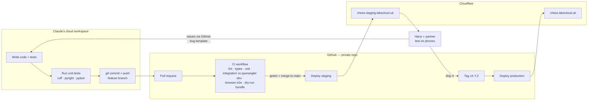

# labscloud-chess — Build Plan

> **Note (12 Oct 2026):** this is the original build plan. Where it differs from `docs/requirements.md`, `docs/protocol.md`, `docs/data-model.md`, `docs/platform-notes.md` or the ADRs in `docs/adr/`, those documents win. Notable changes: player keys instead of emails (ADR-0010), repetition counts instead of replay (ADR-0007), `/game/*` served by the Worker (ADR-0006), `PLAYERS_JSON` format (data model §4).

**Companion to:** `labscloud-chess-architecture.md` (v1.0)
**Status:** Draft v1.0 — 12 October 2026 — *plan only; build not started*
**Delivery model:** Code is written and tested in Claude's cloud workspace → pushed to GitHub → GitHub Actions tests and deploys → Cloudflare. **Nothing is installed, built or run on Harry's PC.** Harry's hands-on involvement is limited to one-off account setup (dashboards) and testing on phones.

---

## Part A — How the pipeline works

### A.1 The "no PC" delivery pipeline



### A.2 Where each kind of testing happens

| Layer | Where it runs | What it proves |
|---|---|---|
| Lint, format, types, unit tests | Claude's workspace **and** CI | Python logic is correct (chess rules, protocol, auth parsing). |
| Integration tests | **CI** (GitHub-hosted Ubuntu runner running `pywrangler dev`) | Worker + Durable Objects + SQLite + WebSockets behave together in the real local runtime. Claude's workspace has restricted network access, so the full local runtime may not install there; CI has no such limit. |
| Browser end-to-end tests | **CI** (Python Playwright, desktop + iPhone-sized viewports, two simultaneous players) | The UI works: moves, promotion, reconnect, game over. Screenshots are kept as CI artefacts. |
| Bundle check | CI (`pywrangler deploy --dry-run`) | The Worker and its packages bundle for Cloudflare before anything is deployed. |
| Smoke test | CI, after staging deploy (`/healthz`, exempted from login) | The deployed build is live and is the commit we expect. |
| Real-device acceptance | **Phones**, on staging | It feels right on iPhone Safari alongside FaceTime, over mobile data. |
| CPU-budget check | Phone, via a protected `/diag` page on staging | Real Cloudflare enforces the 10 ms CPU limit; local runtimes don't. |

### A.3 Branching and release model

- `main` is always deployable. Every push to `main` deploys **staging** automatically.
- Work happens on short-lived branches `task/T-0xx-short-name`, one PR per task, merged only when CI is green.
- **Production** deploys only when a version tag (`v0.1.0`, `v0.2.0`, …) is pushed. Harry says "ship it", Claude tags. Tag-based release keeps this free and avoids paid GitHub environment-protection features.
- A manual **Rollback** workflow (`workflow_dispatch`) redeploys the previous tag.

### A.4 Environments

| | development | staging | production |
|---|---|---|---|
| Runs on | CI runner (`pywrangler dev`) | Cloudflare | Cloudflare |
| Worker name | — | `labscloud-chess-staging` | `labscloud-chess` |
| URL | `localhost:8787` (inside CI) | `chess-staging.labscloud.uk` | `chess.labscloud.uk` |
| Auth | Dev bypass (`?as=harry` / `?as=partner`, only when `APP_ENV=development`) | Cloudflare Access (own app + AUD) | Cloudflare Access (own app + AUD) |
| Email | Captured to log | Real, to the two verified addresses | Real |
| Durable Objects | Local SQLite in `.wrangler/state` | Separate namespaces | Separate namespaces |

Both environments are defined in one `wrangler.jsonc` using `env.staging` and `env.production` blocks. Durable Object bindings and migrations are declared per environment.

### A.5 Getting past Cloudflare Access from CI

The whole hostname sits behind Access, so CI can't call it like a browser.
- **`/healthz`** gets an Access **Bypass** policy on both hostnames. It returns only `{version, commit, env, ok}`: no game data, no player data. CI uses it to confirm each deploy.
- Anything deeper (e.g. a scripted game against staging) needs an Access **service token**. Service tokens on the Zero Trust free plan need checking in the dashboard during setup. If they're available, CI gets a full post-deploy game test. If not, the protected `/diag` page covers it from Harry's phone.

---

## Part B — Harry's one-off setup checklist

Claude can't do these from here, because they need your accounts. Each step is dashboard clicks, no terminal, and none of it needs your PC; a phone or iPad browser works, though a laptop browser is easier.

| ID | When | Task | What to send back to Claude |
|---|---|---|---|
| **H-01** | Before Phase 0 | Create an **empty private GitHub repo** called `labscloud-chess`. | The `owner/repo` name. Claude attaches it to the session with push access. |
| **H-02** | Before Phase 0 | Cloudflare → **API Tokens** → create a token from the *Edit Cloudflare Workers* template. Scope it to your account and the `labscloud.uk` zone only. | Nothing; the token goes straight into GitHub, never into chat. |
| **H-03** | Before Phase 0 | GitHub repo → **Settings → Secrets and variables → Actions**. Add `CLOUDFLARE_API_TOKEN` and `CLOUDFLARE_ACCOUNT_ID`. | Confirmation it's done. |
| **H-04** | Before Phase 3 | **Zero Trust**: create the organisation (free plan) and enable *One-time PIN*. Create **two** self-hosted Access apps, `chess-staging.labscloud.uk` and `chess.labscloud.uk`, each with an Allow policy for your two emails and a 30-day session. Add a **Bypass** policy for path `/healthz` on each. Check whether **Service Auth → Service Tokens** is available on the free plan. | Add three more GitHub secrets: each app's **AUD tag** as `ACCESS_AUD_STAGING` and `ACCESS_AUD_PROD`, and your team domain as `ACCESS_TEAM_DOMAIN` (e.g. `https://<team>.cloudflareaccess.com`). Tell Claude it's done and whether service tokens are available. |
| **H-05** | Before Phase 3 | Add GitHub secret `PLAYERS_JSON` in exactly this shape (keys `harry` and `partner`; names are only defaults, each of you can change yours in the lobby): `{"harry": {"email": "you@…", "name": "Harry"}, "partner": {"email": "them@…", "name": "Partner"}}` | Confirmation. |
| **H-06** | Before Phase 6 | Check you don't receive mail at `@labscloud.uk` elsewhere. Then **Email → Email Routing** on `labscloud.uk`: enable it and add both personal addresses as **destination addresses**. You each click Cloudflare's verification email. | Confirmation both are verified. |
| **H-07** | Each milestone | Phone testing on staging using the UAT script (Part E). Report issues with the GitHub **Bug report** form, which Claude creates in Phase 0. | Issues, or "ship it". |

CI uploads the Worker secrets (`PLAYERS_JSON`, `ACCESS_AUD`, `ACCESS_TEAM_DOMAIN`) together with the code on every deploy (`wrangler deploy --secrets-file`), sourcing them from the GitHub secrets above. You never set Worker secrets by hand. A deploy fails with a clear message if one is missing.

---

## Part C — Phased build plan

Each task has an ID, the files it touches, acceptance criteria (AC) and its tests. A task is **Done** only when it meets the Definition of Done in Part D.

### Phase 0 — Foundations (repo, tooling, CI/CD, hello world live)

**Goal:** a trivial Python Worker is deployed to `chess-staging.labscloud.uk` by CI, before any game code exists. This proves the whole pipeline end to end.

| ID | Task | Files | Acceptance criteria |
|---|---|---|---|
| T-001 | Scaffold project with `uv` and `pywrangler init`. Pin Python, `workers-py`, `python-chess` and `compatibility_date`, and commit `uv.lock`. | `pyproject.toml`, `uv.lock`, `wrangler.jsonc`, `src/entry.py`, `.gitignore`, `.python-version` | `uv sync` works from clean; versions pinned exactly. |
| T-002 | Quality tooling: `ruff` (lint + format), `pyright` (strict on `src/chess_core`), `pytest` + `pytest-cov`, and `pre-commit` config for consistency. | `pyproject.toml`, `pyrightconfig.json`, `.pre-commit-config.yaml` | All gates run with one command, `uv run ./scripts/check.sh`. |
| T-003 | Project docs skeleton: `CLAUDE.md`, `docs/requirements.md`, `docs/protocol.md`, `docs/test-plan.md`, `docs/platform-notes.md`, `docs/tasks.md`, `docs/progress.md`, `docs/runbook.md`, `docs/adr/`. See Part F. | `docs/**`, `CLAUDE.md` | Docs exist with real content, not stubs, for requirements, protocol and platform notes. |
| T-004 | `/healthz` endpoint returning `{ok, version, commit, env}`. The commit SHA is injected by CI as a Worker var. | `src/entry.py` | Returns 200 JSON; no other data exposed. |
| T-005 | CI workflow: on PR and push, run `uv sync`, then ruff, pyright, pytest with coverage, then `pywrangler deploy --dry-run`. | `.github/workflows/ci.yml` | Green on the scaffold; fails the build on any lint, type or test error. |
| T-006 | Deploy workflows: `main` deploys staging, `v*` tag deploys production, and a manual rollback workflow. Each deploy pushes secrets, then smoke-tests `/healthz` and checks the commit matches. | `.github/workflows/deploy-staging.yml`, `deploy-prod.yml`, `rollback.yml` | First staging deploy succeeds; smoke test passes; `workers_dev` and `preview_urls` are off. |
| T-007 | GitHub templates: bug report form (device, browser, game link, expected vs actual, screenshot), PR template with DoD checklist. | `.github/ISSUE_TEMPLATE/bug.yml`, `.github/pull_request_template.md` | Harry can file a bug from his phone. |

**Milestone M0:** `https://chess-staging.labscloud.uk/healthz` shows the latest commit, deployed entirely by CI. *Harry checks it on his phone.*

### Phase 1 — Risk spikes (prove the platform before building on it)

Each spike has an exit criterion and a fallback decided in advance. Spike code lives on a `spike/*` branch and is either promoted or deleted.

| ID | Spike | Exit criterion | Fallback if it fails |
|---|---|---|---|
| S-01 | `python-chess` bundles with pywrangler and imports in the Pyodide runtime. `/healthz?probe=chess` returns 20, the number of legal moves from the starting position. | Works on staging. | Vendor the pure-Python source manually; if that also fails, write a minimal move generator (large effort — escalate to Harry). |
| S-02 | **Durable Object with a hibernating WebSocket in Python.** An echo room that survives client reconnect, tested in CI with a Python `websockets` client against `pywrangler dev`. | CI integration test green; manual echo works on staging via `/diag`. | Non-hibernating WebSockets (still free at this scale, just less efficient). |
| S-03 | **Access JWT verification from Python** using the runtime's WebCrypto through the JS bridge. Unit-tested with a locally generated RSA key pair; validated against real Access on staging. | Valid token is accepted; tampered, expired and wrong-AUD tokens are rejected. | Pure-Python RSA verification using the `cryptography` package from Pyodide (more CPU, so it needs measuring). |
| S-04 | **CPU budget.** The `/diag` page (behind Access) replays a stored 150-ply game move by move through a throwaway GameRoom. It also runs a worst-case reconnect that rebuilds the board from the full move list. | No *Exceeded CPU* errors in Worker metrics; Harry runs it on his phone and screenshots the result. | In order: cache per-ply position hashes so the full list is never replayed; move repetition checks to on-demand only; as a last resort, discuss Workers Paid. |
| S-05 | **Email binding from Python** sends to one verified address (needs H-06). | Email arrives. | A free third-party email API over `fetch`. |

**Milestone M1:** all five spikes pass. ADRs record the outcomes in `docs/adr/`. Build proceeds with no platform unknowns left.

### Phase 2 — Chess core (pure Python, test-first)

No Cloudflare imports in this layer. 100% of it can be tested in Claude's workspace.

| ID | Task | Acceptance criteria |
|---|---|---|
| T-010 | **Rules edge-case catalogue** written as FEN fixtures *before* any code. Covers castling (both sides, through check, out of check, after rook or king moved), en passant (normal, pinned, expiry), every promotion and underpromotion, checkmates (back-rank, smothered, two-rook), stalemates, insufficient material (K v K, K+B v K, K+N v K, same-colour bishops), the 75-move rule, fivefold repetition, and claimable threefold and 50-move draws. | ≥ 40 named fixtures in `tests/fixtures/positions.py`, each with expected legal-move count and status. |
| T-011 | `ChessGame` wrapper (`apply`, `legal_moves`, `status`, `can_claim_draw`, `turn`, `ply`): turn and stale-ply checks, UCI regex, outcome dataclass. | All fixtures pass; branch coverage ≥ 95% on `chess_core`; pyright strict clean. |
| T-012 | Protocol module: dataclasses for every client and server message, `parse()` that rejects unknown types and fields, `to_json()`. JSON Schema in `docs/protocol.schema.json`, plus golden fixtures. | Round-trip tests; every error code in `docs/protocol.md` has a test that produces it. |
| T-013 | PGN export with headers (Event, Site, Date, White, Black, Result). | Output re-parses with `chess.pgn` to an identical move list. |
| T-014 | Property-based tests (`hypothesis`): random legal games never raise errors; `apply` never accepts an illegal move; the FEN after each move equals a replay from scratch. | 500 generated games per CI run. |

**Milestone M2:** chess core complete and green in CI.

### Phase 3 — Server: Worker, GameRoom, Lobby

| ID | Task | Acceptance criteria |
|---|---|---|
| T-020 | `entry.py` router and `auth.py`. JWT verification with cached signing keys. Email allow-list from `PLAYERS_JSON`. Dev bypass **only** when `APP_ENV == "development"`. Origin check on WebSocket upgrade. Security headers (CSP, nosniff, referrer policy). | Unit tests cover every auth rejection path, including a test that production config **rejects** `?as=`. |
| T-021 | `GameRoom` DO, part 1: schema with a `schema_version` table; init; WebSocket accept with a colour tag and serialised attachment; `hello` returns a full snapshot; `move` validates, persists and broadcasts; presence; lazy rebuild after hibernation. | Integration tests: full game to checkmate; wrong turn; stale ply; illegal move; a third, unauthorised email gets 403. |
| T-022 | `GameRoom` DO, part 2: resign, draw offer/accept/decline, claim draw, rematch votes, no actions after game over. | An integration test for each flow, including races such as both players offering a draw at once. |
| T-023 | `Lobby` DO: seed players from `PLAYERS_JSON`; create game (colour choice, random), list, stats; receives summaries from GameRoom. | Tests for colour assignment, list ordering and stats after mixed results. |
| T-024 | REST API: `/api/me`, `/api/games`, `/api/games/{id}`, `/api/games/{id}/pgn`, `/api/stats`. | Contract tests against `docs/protocol.md`. |
| T-025 | **Resilience tests in CI:** restart `pywrangler dev` mid-game (state persists in local SQLite), reconnect both clients, and confirm the board is identical; plus a double-submit of the same move. | Green. |
| T-026 | Structured JSON logging (`event`, `game_id`, `ply`, `latency`) and `observability` enabled in the wrangler config. | Logs visible in the Cloudflare dashboard on staging. |

**Milestone M3:** two scripted Python clients can play a complete game against staging through `/diag`, or through CI if service tokens are available.

### Phase 4 — Frontend (vanilla JS, mobile-first)

| ID | Task | Acceptance criteria |
|---|---|---|
| T-030 | ~~Vendor `cm-chessboard`~~ **Superseded (ADR-0005 revised):** hand-rolled board in `public/js/board.js` with no runtime CDN. This simplifies the CSP and removes a third-party dependency at game time. | Licence file included; version recorded in `docs/platform-notes.md`. |
| T-031 | Lobby page: new game with colour picker, active games with "Your move" badge, finished games with PGN link, head-to-head score. | Matches `docs/ui-spec.md` states: empty, loading, error. |
| T-032 | Board page: orientation by colour; tap-tap **and** drag input; legal-target highlights from the server's `legal` list; promotion picker; move list; opponent online dot; resign (confirm), draw controls, rematch. | Every state in the UI spec is reachable in e2e tests. |
| T-033 | WebSocket client state machine: `connecting → open → reconnecting → closed`, with exponential back-off and jitter; resync on `visibilitychange` and `online`; input disabled while not synced. | E2E test drops the socket mid-game and recovers with no duplicate moves. |
| T-034 | Phone niceties: Screen Wake Lock, move/capture/check sounds (muted by default, toggle remembered), vibration where supported, safe-area insets, controls clear of the FaceTime picture-in-picture corners, PWA manifest and icons. | Manual UAT on iPhone. |
| T-035 | **Browser e2e in CI (Python Playwright):** two browser contexts as Harry and partner, desktop plus an iPhone-sized viewport. Covers a full game, promotion, resign, draw, reconnect and rematch. Screenshots uploaded as CI artefacts for review. | Green; screenshots attached to each PR. |
| T-036 | Accessibility basics: keyboard-operable board, ARIA live region announcing opponent moves in SAN, sufficient contrast. | Automated axe check in the e2e run reports no serious violations. |

**Milestone M4 — playable on staging.** Harry and partner run the UAT script (Part E) on their phones with FaceTime on.

### Phase 5 — Production launch

| ID | Task | Acceptance criteria |
|---|---|---|
| T-040 | Production env config, Access AUD and secrets wired; tag `v0.1.0`. | Production `/healthz` shows `v0.1.0` and matching commit. |
| T-041 | Post-launch check: both players log in with a PIN on production and play one full game. | Harry confirms. |
| T-042 | `docs/runbook.md` finalised: deploy, rollback, rotate API token, add or remove a player, read logs, what to do if Access emails don't arrive. | Harry can follow it on a phone. |

**Milestone M5 — live at `chess.labscloud.uk`.**

### Phase 6 — Email notifications

| ID | Task | Acceptance criteria |
|---|---|---|
| T-050 | `notify.py`: templates for invite, your move and game over (plain text + simple HTML), sent from `chess@labscloud.uk`. | Snapshot tests of rendered emails. |
| T-051 | Rules: send the invite on game creation; send "your move" only if the opponent has no open socket, the cooldown (default 30 min) has elapsed, and they've opted in; game over goes to both. | Unit tests for the throttle; staging test with real inboxes. |
| T-052 | Notification preferences on the lobby page. | Toggles persist. |

**Milestone M6 — tag `v0.2.0`.**

### Phase 7 — Polish backlog (prioritise together later)

Optional clocks via DO alarms; captured-pieces bar and material count; board and piece themes; in-browser post-game analysis (Stockfish WASM, client-side); Web Push for the installed PWA; weekly PGN archive; puzzles.

---

## Part D — Quality gates and Definition of Done

### D.1 Definition of Done (every task)

1. Acceptance criteria met and traceable: each AC maps to a requirement ID in `docs/requirements.md` and at least one test.
2. Tests were written **before or alongside** the code. Existing tests are never deleted or weakened to make a change pass; if a test is wrong, that's raised explicitly.
3. `ruff`, `pyright` and `pytest` all pass in the workspace, then CI is green on the PR, including integration, e2e and dry-run.
4. No new dependency without a recorded reason; everything pinned.
5. `docs/progress.md` and `docs/tasks.md` updated; an ADR is written if a decision changed.
6. For user-visible changes: CI screenshots reviewed, and the staging deploy verified via `/healthz`.

### D.2 Engineering rules (go into `CLAUDE.md`)

- **Layering:** `chess_core` is pure Python with no Workers imports. Durable Objects and the Worker are thin adapters. All I/O happens at the edges.
- **Server is authoritative:** the browser never decides legality.
- **Hibernation-safe:** never rely on in-memory state surviving between messages; every handler can rebuild from SQLite plus socket attachments.
- **CPU-aware:** no full-history replay on the hot path; anything costly runs on demand.
- **Additive migrations only:** never rename or delete a Durable Object class or column; bump `schema_version`.
- **Security:** never trust the plain email header, only the verified JWT. The dev bypass must be impossible in production. No secrets in the repo or the browser.
- **Minimalism:** no speculative features, abstractions or config knobs beyond the task.
- **Platform claims are verified:** any Python Workers or Pyodide API used must be confirmed against current Cloudflare docs or a passing test, and recorded in `docs/platform-notes.md`.

---

## Part E — UAT script (phones, staging)

Run with FaceTime active on both iPhones, one of you on mobile data.
1. Open the staging link, enter your email, receive the PIN, log in. Check you stay logged in the next day.
2. Harry creates a game with random colours. Partner gets the invite (Phase 6+) or sees it in the lobby.
3. Play the opening moves. Each move should appear on the other phone within a second.
4. Swipe to FaceTime full-screen for 30 seconds, come back, and check the board resyncs correctly.
5. Turn on airplane mode for 10 seconds, then off; you should see the "Reconnecting…" pill, then a correct board.
6. Try an illegal move (it shouldn't be possible), a promotion (the picker should work), and castling.
7. Offer a draw and decline it. Offer again and accept. Rematch, and check colours swap.
8. Resign a game and check the lobby score.
9. Download a PGN and open it in any chess app.
10. Lock the phone mid-game, then unlock and continue.

---

## Part F — Supporting documents that raise code quality

These turn implicit knowledge into explicit, checkable context, which is the biggest lever on bug-free AI-written code. Each lives in the repo, is read at the start of every build session, and is updated as part of the Definition of Done.

| Priority | Document | What it contains | Why it prevents bugs |
|---|---|---|---|
| **Must** | `CLAUDE.md` | Project purpose in 5 lines; commands (`check.sh`, how CI runs); directory map; the engineering rules (D.2); DoD; "never do" list; pointers to the other docs. | Read automatically at session start; keeps every session consistent. |
| **Must** | `docs/requirements.md` | Numbered requirements (REQ-001…) in **EARS** form, e.g. *"When a player submits a move that is not legal, the system shall reject it with `ILLEGAL_MOVE` and leave the game state unchanged."* Includes non-functional requirements (CPU, cost, security). | Removes ambiguity; every test traces to a REQ. |
| **Must** | `docs/protocol.md` + `docs/protocol.schema.json` | Every WebSocket and REST message, field types, error codes, example payloads, ordering guarantees. | The client–server contract is where real-time apps usually break; a schema makes it testable on both sides. |
| **Must** | `docs/test-plan.md` + `tests/traceability.json` | Test strategy per layer; matrix of REQ → test IDs → status (passing, failing, not started). | Structured state that survives across sessions; gaps are visible at a glance. |
| **Must** | `docs/platform-notes.md` | **Verified** facts about Python Workers, Pyodide, Durable Objects, Access and the Email binding: exact import paths, working snippets, known limitations, pinned versions, doc links and the date checked. | Stops plausible-but-wrong API usage, the most likely bug source on a newly GA platform. |
| **Must** | `docs/tasks.md` + `docs/progress.md` | The task list above as checkboxes; a session-by-session log of what was done, what's next, open questions and the last CI result. | Clean hand-over between sessions; nothing silently forgotten. |
| **Should** | `docs/ui-spec.md` | Screen inventory and **every state** of each screen (loading, empty, waiting for opponent, your turn, their turn, check, reconnecting, game over by each cause, error), mobile layout rules, simple ASCII wireframes. | UI bugs are mostly unhandled states; listing them makes e2e tests obvious. |
| **Should** | `tests/fixtures/positions.py` (rules catalogue) | Named FEN positions with expected outcomes (T-010). | Chess edge cases are where hand-written logic usually fails. |
| **Should** | `docs/adr/NNN-*.md` | One page per decision: context, decision, consequences, status. Includes the six ADRs from the architecture doc plus spike outcomes. | Prevents relitigating decisions or quietly drifting from them. |
| **Should** | `docs/runbook.md` | Setup (Part B), deploy, rollback, secret rotation, adding a player, log access, troubleshooting. | Operational mistakes are bugs too. |
| **Could** | `docs/email-copy.md` | Final wording of every email. | Keeps templates and tests in sync. |
| **Could** | `CHANGELOG.md` | Per-tag notes. | Shows what changed between staging tests. |

---

## Part G — Prompt structure for build sessions

Based on Anthropic's current prompting guidance (clear and direct instructions, context and motivation, XML-tagged sections, success criteria, structured state across sessions, git as a checkpoint, not editing tests to pass, keeping scope tight, investigating before answering) and spec-driven practice (requirements → design → tasks, with the spec as the source of truth).

### G.1 One structure, used every session

```text
<role>
  One line: who Claude is for this session.
</role>

<project_context>
  Pointers, not copies: "Read CLAUDE.md, then docs/requirements.md,
  docs/protocol.md, docs/platform-notes.md." Long reference material
  goes first, instructions last.
</project_context>

<current_state>
  Branch, last tag, last CI result, link to docs/progress.md, anything
  that changed since last session (e.g. "service tokens ARE available").
</current_state>

<task>
  Exactly one task ID (or a tightly related pair), e.g. T-021. Say
  "implement", not "suggest".
</task>

<acceptance_criteria>
  The task's ACs and the REQ IDs they satisfy. What "done" looks like
  in observable terms.
</acceptance_criteria>

<constraints>
  Python only (vanilla JS in public/ only); £0 platform; engineering
  rules from CLAUDE.md; files allowed or not allowed to change; no new
  dependencies without justification; never weaken or delete tests.
</constraints>

<research_permission>
  Whether to check live docs, and that any platform API used must be
  verified and recorded in platform-notes.md.
</research_permission>

<process>
  Investigate the relevant files first → state a short plan → write or
  extend tests → implement → run check.sh → commit on a task branch →
  push → open PR → wait for CI → fix until green → update tasks.md and
  progress.md.
</process>

<stop_and_ask_if>
  Spec ambiguity or contradiction; a test appears wrong; a spike
  fallback is needed; anything irreversible (deleting data, force-push,
  production deploy, changing Access or DNS).
</stop_and_ask_if>

<report_back>
  What changed (files), CI status and link, deviations from spec,
  decisions made, open questions, what's next. Short.
</report_back>
```

### G.2 Session types that reuse the structure

| Session | How the sections are filled |
|---|---|
| **Kick-off** (first session only) | `<task>` = T-001 to T-007 plus writing the must-have docs from Part F. `<process>` adds: draft requirements and protocol first and stop for Harry's review before writing code. |
| **Spike** | `<task>` = S-0x. `<acceptance_criteria>` = the exit criterion. `<stop_and_ask_if>` includes "exit criterion not met", so the pre-agreed fallback isn't applied silently. |
| **Feature task** | The standard form above, one task per session or PR. |
| **Bug fix** | `<task>` = GitHub issue number. Add `<repro>` (device, browser, steps, expected vs actual, screenshot, game link). `<process>` starts with "write a failing test that reproduces it". |
| **Review and hardening** | `<task>` = review a phase against requirements and protocol. Ideally a fresh session or subagent that didn't write the code, so the work isn't grading itself. Output is a findings list, not edits. |
| **Release** | `<task>` = tag vX.Y.Z. `<stop_and_ask_if>` = always confirm with Harry before tagging production. |

### G.3 Tips that make the structure work

- **One task per prompt.** Small, verifiable increments beat "build the game".
- **Explain why a constraint exists** (e.g. "10 ms CPU limit on the free plan, so no history replay on the hot path"). Claude generalises from reasons better than from bare rules.
- **Point to files rather than pasting them**, so the repo stays the single source of truth.
- **Phrase instructions positively** ("render state from the server snapshot") rather than as prohibitions.
- **Keep the "never do" list short** and in `CLAUDE.md`, not repeated in every prompt.

---

## Part H — Sequencing summary

| Order | Phase | Gate to proceed | Needs from Harry |
|---|---|---|---|
| 1 | Part B steps H-01–H-03 | Repo and secrets exist | ~15 min of dashboard work |
| 2 | Phase 0 + must-have docs | **Harry reviews requirements, protocol and UI spec** | Review (on phone) |
| 3 | Phase 1 spikes | All exit criteria met (S-05 can wait until H-06) | H-04, H-05; run `/diag` on phone |
| 4 | Phase 2 | M2 green | — |
| 5 | Phase 3 | M3 green | — |
| 6 | Phase 4 | M4 UAT passed | UAT with partner |
| 7 | Phase 5 | Live | Say "ship it" |
| 8 | Phase 6 | Emails received | H-06 |
| 9 | Phase 7 | Ongoing | Prioritise backlog |

### Main risks to the plan itself

| Risk | Mitigation |
|---|---|
| The full Python Workers local runtime may not install in Claude's restricted workspace. | Integration and e2e tests run in CI, which has normal internet access. The workspace handles everything pure-Python. Slower feedback, same rigour. |
| CI feedback loop is slower than local testing. | Keep `chess_core` pure so most tests run instantly in the workspace; cache `uv` and Playwright in CI. |
| GitHub Actions minutes on a private repo. | Expected well inside the free allowance for private repos at this size. Cache dependencies; run e2e only on PRs touching `public/` or `src/`. |
| Cloudflare APIs drift during the build. | Pin `compatibility_date` and package versions; keep `platform-notes.md` dated; re-verify when upgrading. |

---

## References

- Cloudflare: deploying Workers from GitHub Actions — https://developers.cloudflare.com/workers/ci-cd/external-cicd/github-actions/
- Cloudflare: Access service tokens — https://developers.cloudflare.com/cloudflare-one/identity/service-tokens/
- workers-py / pywrangler — https://pypi.org/project/workers-py/
- Example Python Worker with CI (dry-run + deploy workflows) — https://github.com/scitokens/scitokens-heroku
- Anthropic: Prompting best practices — https://platform.claude.com/docs/en/build-with-claude/prompt-engineering/claude-prompting-best-practices
- Addy Osmani: How to write a good spec for AI agents — https://addyosmani.com/blog/good-spec/
- JetBrains: Spec-driven approach for coding with AI — https://blog.jetbrains.com/junie/2025/10/how-to-use-a-spec-driven-approach-for-coding-with-ai/
